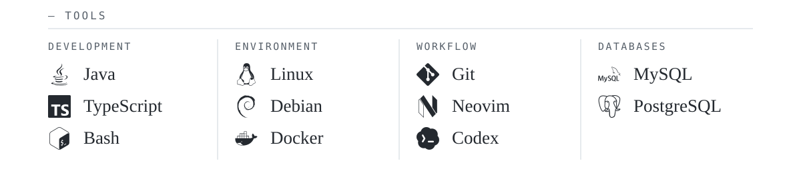

<picture>
  <source media="(prefers-color-scheme: dark)" srcset="assets/tools-v2-dark.svg">
  <source media="(prefers-color-scheme: light)" srcset="assets/tools-v2-light.svg">
  
</picture>

<!-- Visual layout adapted from https://github.com/beydemirfurkan/awesome-github-profile/blob/main/assets/minimal/editorial-card.svg (MIT). -->
